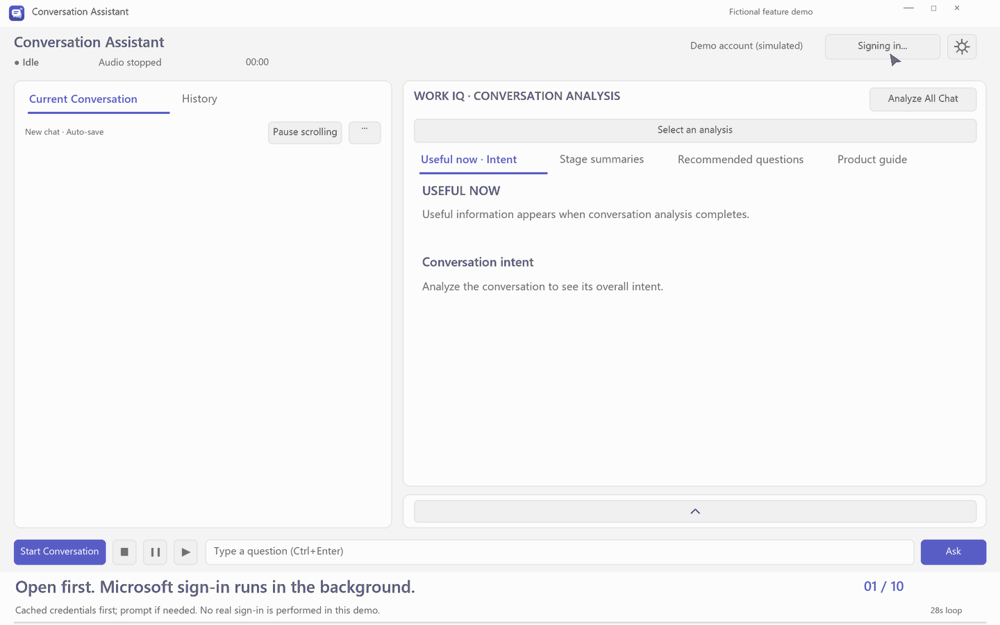

# Conversation Assistant

Windows WinUI 3 / .NET 10 desktop application. **Supports speaker-labeled transcript groups, Work IQ analysis history, linked replies, and importable JSON conversation records.** Continues to use Microsoft Entra ID identities in the target resource tenant to access Azure AI Speech, without using a resource key. Azure Speech and Work IQ share a sign-in entry point while managing their own credentials separately; Whisper offline mode can also be selected explicitly. Transcription and Q&A run independently.

## Animated demo

[Watch the 28-second English feature tour](docs/demos/conversation-assistant-current-en.gif) · [Chinese version](docs/demos/conversation-assistant-current-zh.gif) · [Storyboard and regeneration instructions](docs/demos/README.md)



A fictional UI simulation of the current Teams-inspired interface: read-only live transcripts, 20/20/60 history columns, whole-document selection, recommendations, product guidance, answer expansion/right-click collapse, and save-before-New-Chat. English and Chinese editions are available; each is 28.0 seconds, including transitions. All conversations and sign-in results are simulated; no user data, live service calls or verified pricing are shown.

[Previous longer English Power Platform tour](docs/demos/conversation-assistant-power-platform.gif)

## Prerequisites

- Windows 11 (x64), .NET 10 SDK, and Windows App SDK build dependencies (restored through NuGet); Windows Developer Mode is required for packaged debugging. To use a microphone, allow desktop app access in Windows privacy settings. **Windows SAPI language packs are no longer required.**
- Azure mode requires an **Azure AI Services / Speech custom resource Endpoint, an organizational work account, and resource RBAC permissions**. No key, client secret, or Azure OpenAI is required. Azure public cloud `*.cognitiveservices.azure.com` is currently supported. Listening audio is sent to the configured Azure resource and may incur charges; the app does not change the resource's key-disabling policy.
- The offline `ggml-small.bin` model (about 466 MiB) is still included for explicit use with Whisper; its SHA-1 is `55356645c2b361a969dfd0ef2c5a50d530afd8d5`. Whisper mode also requires about **44 MiB of local speaker models**, provisioned explicitly before building as described below. Whisper prefers the Vulkan GPU and falls back to the local CPU; audio is not uploaded. Model source: [official whisper.cpp model list](https://github.com/ggml-org/whisper.cpp/blob/master/models/README.md); license: `App\Models\LICENSE-*.txt`.
- The input language defaults to **Chinese (zh-CN)**, with **English (en-US)** also available; this provides speech-to-text, not translation between Chinese and English. Pause and resume to change the language. `Auto` under answer language controls only the language of Work IQ responses.
- [Install the official Work IQ CLI](https://github.com/microsoft/work-iq) and obtain `workiq.exe`. The app uses the executable (not a `.cmd` script) and safely passes questions as an argument list. If it is not on PATH, set the `CONVERSATIONASSISTANT_WORKIQ_PATH` environment variable to the **absolute path** of `workiq.exe`; restart the app to read the new variable. The legacy variable `MEETINGCOPILOT_WORKIQ_PATH` remains supported when the new variable is unset. If Microsoft Scout is installed locally, the app also attempts to discover the official CLI bundled with it.
- Before use, read and accept the [Work IQ evaluation terms](https://github.com/microsoft/work-iq/tree/main/EULA) by running `workiq accept-eula` in a terminal as directed by the official instructions. The Work IQ CLI manages its own OAuth cache; this app does not read its token files. The work account obtained through Entra sign-in is used for the CLI's `--account` argument, and the same account is explicitly specified for subsequent questions. Work IQ admin consent and a Microsoft 365 Copilot license are separate from Azure RBAC; see the [official tenant enablement guide](https://github.com/microsoft/work-iq/blob/main/ADMIN-INSTRUCTIONS.md).
- Rich-text answers use the **Microsoft Edge WebView2 Runtime** on Windows, which is usually installed with Windows 11. If it is missing, the app displays the raw answer and an error. The app creates an InPrivate WebView2 session and disables scripts, host objects, and automatic external resource requests.

## Shared microphone and system audio

- Open **Settings / 设置 → Audio sources (shared mode) / 音频来源（共享模式）**. **Microphone + system audio** is selected by default; **Microphone only** and **System audio only** remain available. Pause listening before changing sources or devices; Resume opens the selected devices again.
- Microphone input uses **WASAPI shared capture**. System playback uses **WASAPI shared loopback** on the selected output endpoint. Both explicitly use `AudioClientShareMode.Shared`, with no exclusive-mode fallback. The app does not play captured audio back, change default devices, modify endpoint volume/mute, or change Teams settings.
- To transcribe both sides of a Teams call, select **Microphone + system audio**, then match the input and playback devices configured in Teams. The **default communications** choices follow Windows' communications endpoints; these may differ from the normal multimedia defaults. A Teams-specific speaker choice must be selected explicitly here. Physical device choices use stable endpoint IDs, not names or enumeration indexes.
- Windows converts each shared capture stream to 16 kHz, 16-bit mono PCM without changing the endpoint's mix format. Both sources are mixed into one real-time stream, not concatenated; missing loopback packets become silence so microphone input and speech finalization keep working. Audio is kept in bounded memory buffers and is not written to disk.
- Mixed audio follows a monotonic clock and catches up when timer notifications are delayed or coalesced. Device discovery runs separately from audio delivery, so slow Windows endpoint queries do not accumulate a recording backlog. The two-second per-source buffer limit remains in place: genuine overload still reports an error rather than dropping audio silently or growing memory without a bound.
- A device disconnect, selected-default change, startup failure, or capture error stops **both** selected sources and makes listening resumable. The app reports the error instead of silently switching to another microphone, dropping one side of a conversation, or claiming it is still recording.
- **Privacy:** loopback captures all applications playing through that output, not only Teams. In Azure mode, the selected microphone **and/or system audio** is sent to the configured Speech service; Whisper remains local. Confirm participant consent and use headphones to avoid speaker audio being picked up again by the microphone. Audio mixing does not cancel echo or separate overlapping voices; speaker diarization is performed by the recognition pipeline below.
- Shared mode is designed to coexist with Teams and other shared-mode clients. An external app using exclusive mode, microphone privacy denial, driver limitations, Bluetooth hands-free profile changes, or protected playback can still prevent capture. The app never attempts to seize a device, bypass these restrictions, or change another app's configuration.

Audio regression tests cover source routing, exact mixed PCM duration, five-minute streams with coalesced timer notifications, wall-clock changes, slow device discovery, silent playback, bounded buffers, stable endpoint selections, device changes, partial startup failures, callback-driven stop/restart, and releasing both sources. A 90-second native microphone-plus-loopback check completed without overflow and kept delivered audio duration within 250 ms of elapsed time, even while individual endpoint queries took about 500 ms. Separate local checks verified concurrent shared capture clients and shared playback, including that stopping one client leaves another running and preserves default devices, volume, and mute. These checks store byte counts only, with no raw recordings or cloud recognition. This is not a live Teams-call test or a guarantee for every driver.

## Speaker-aware transcription

- Azure mode uses the Speech SDK's **ConversationTranscriber** with real-time diarization, not a plain SpeechRecognizer. It identifies anonymous speakers from the audio, including speakers sharing one microphone or playback device. The app does not infer people from device channels, punctuation, names in the text, or alternating sentences.
- Offline mode uses **sherpa-onnx 1.13.8**, a trained pyannote segmentation model and 3D-Speaker ERes2Net voice embeddings. It detects speaker changes within a final audio window, transcribes each acoustic turn separately with Whisper, and matches anonymous voices across windows in the same listening session. It no longer concatenates different detected speakers into one final transcript.
- Each recognized speaker turn becomes its own transcript card. **Speaker 1 / Speaker 2** (or **说话人 1 / 说话人 2**) is shown alongside the time; the original recognized text is preserved. Interim captions retain attribution when available; copied transcripts, manual context and complete Work IQ conversation analysis also retain speaker labels.
- Numbering is anonymous and local to the current transcript. An unresolved voice is shown as **Speaker not identified / 说话人未识别**, not assigned a fabricated identity. A new recognition connection, including Resume, starts a fresh acoustic session, so it does not claim that its first speaker is the same person as before. Clear resets transcript numbering.
- Diarization is probabilistic, especially for overlapping speech, very short turns, background noise, similar voices and acoustic echo. It is not verified identity recognition or audio source separation. Use headphones and avoid simultaneous speech where possible.
- Azure's [real-time diarization documentation](https://learn.microsoft.com/azure/ai-services/speech-service/get-started-stt-diarization?pivots=programming-language-csharp) describes the anonymous speaker IDs. Existing saved v1 recognition URLs are normalized to the custom resource root so the SDK can select its diarization transport; Entra authentication and audio consent requirements are unchanged.

### Provision offline speaker models

Run once from the repository root before building or packaging an offline-capable app:

```powershell
powershell -NoProfile -File .\App\Speech\Install-OfflineSpeakerModels.ps1
```

The [provisioning script](App/Speech/Install-OfflineSpeakerModels.ps1) downloads public, licensed ONNX exports and verifies pinned SHA-256 hashes before installing them in `App\Models\Speakers`. Re-running it verifies existing files and avoids another download. The generated directory is git-ignored; the project copies its models, licenses, source information and runtime notices into the app's `Models\Speakers` directory when built or packaged.

| File | Size | License | SHA-256 |
| --- | --- | --- | --- |
| `pyannote-segmentation-3.0.onnx` | 5,992,913 bytes | MIT, CNRS | `220AD67CA923BEF2FA91F2390C786097BF305BCEB5E261D4AF67B38E938E1079` |
| `3dspeaker-eres2net.onnx` | 39,593,761 bytes | Apache-2.0, 3D-Speaker | `1A331345F04805BADBB495C775A6DDFFCDD1A732567D5EC8B3D5749E3C7A5E4B` |

Missing or corrupt models stop offline initialization with an actionable error, before capture starts. **Starting listening never downloads models or falls back to Azure.** Audio and speaker embeddings remain in memory; no voiceprints are persisted or matched against real-world identities. Azure mode does not require these local models.

Offline inference speed depends on hardware. Diarization runs locally on the CPU; Whisper keeps its existing Vulkan/CPU selection. CPU-only tests took roughly 30 seconds to transcribe a 12-second synthetic sample, so slow machines can still hit the bounded inference-backlog error. This is not an audio-device ownership conflict. Pause/stop cancels between bounded native inference calls rather than interrupting a native call mid-execution.

## Configure Azure Speech Entra ID

1. Ask a resource administrator to grant the **Cognitive Services Speech User** (or **Cognitive Services Speech Contributor**) role to the **signed-in user** on the target Azure AI resource. Ordinary Resource Contributor access, successful Work IQ sign-in, or obtaining an Entra token does not imply Speech data access. The app cannot elevate your permissions.
2. Open **Settings**, select **Azure Speech · Entra ID（在线）**, and enter the root Endpoint, for example, `https://your-resource.cognitiveservices.azure.com/`. **No additional Resource ID or region is required**: SDK 1.51's `SpeechConfig.FromEndpoint(Uri, TokenCredential)` supports this mode. A regional `*.stt.speech.microsoft.com` endpoint cannot be used in place of the custom resource domain; a separate sign-in authority for national clouds is not currently configured.
3. **Tenant ID is required and must be the directory ID of the subscription containing the Azure AI resource.** In the Azure portal, open the subscription that owns the resource and find the directory/tenant ID in its properties. This is not a region (such as eastus), and may not be the work account's or Work IQ's home tenant. Cross-directory users must have member/guest status in the resource tenant and be assigned a Speech role. Client ID remains optional; for production, it is recommended to provide the GUID of a public client application approved by the resource tenant. That application must be able to sign in to the target tenant. If left blank, the SDK development client is used and may be restricted by the organization; this is not a way to bypass approval.
4. Your own app registration should configure **Mobile and desktop applications**, use **`http://localhost`** as the system browser redirect URI, enable public client flows according to tenant policy, and approve the required delegated access. Follow [Microsoft's desktop app registration instructions](https://learn.microsoft.com/entra/identity-platform/scenario-desktop-app-configuration) and [Speech Entra authentication instructions](https://learn.microsoft.com/azure/ai-services/speech-service/how-to-configure-azure-ad-auth). The app requests the scope **`https://cognitiveservices.azure.com/.default`**; do not provide a client secret.
5. Enter the Endpoint and resource Tenant ID, check the audio upload authorization box, and save. Then click **Microsoft 登录** at the top: the app first obtains an Entra identity in the specified resource tenant, then signs in to the Work IQ CLI with the same work account and runs a data-free `2+2` availability check. **One button does not mean there will be only one authorization window or that both services are in the same tenant.** The SDK account cache is isolated by Tenant ID / Client ID; changing the Tenant ID invalidates the old token and requires signing in again.
6. Click **测试已保存连接（不录音）** to check the resource connection; this does not turn on the microphone. `BadRequest/HTTP 400 [TenantMismatch]` explicitly means that the token tenant does not match the resource tenant. Correct the resource Tenant ID and sign in again; **you do not need to change the Endpoint or enable a key**. A generic HTTP 400 cannot be attributed to an incorrect address by itself. For `AuthenticationFailure`, check authorization; for `Forbidden`, check Speech RBAC in the target tenant and network rules.
7. Before changing the account, Tenant ID, Client ID, or recognition service, select **End Conversation**. Azure Identity uses an OS-encrypted token cache, and the Speech SDK automatically requests renewal; the app does not automatically display a sign-in window in the background. If MFA or conditional access requires renewed interaction, end the conversation and click Microsoft Sign In again. In offline mode, the sign-in button handles Work IQ only.

After successful verification, the button changes to **已登录 / Signed in** with green text. It shows **正在登录 / Signing in...** while an attempt is running and returns to the ordinary sign-in state after a failed attempt or invalidation of the required Azure identity. In Azure mode both Entra and Work IQ sign-in must be ready; offline mode requires only Work IQ. The signed-in button can still be clicked to reauthenticate when no conversation is active. Its label, hint and accessibility name follow the listening/UI language.

The implementation uses the official `Azure.Identity.InteractiveBrowserCredential` and the Speech SDK's `TokenCredential` overload. It does not construct legacy `aad#...` strings or pass M365/Graph/Work IQ tokens to Speech. The SDK handles routing and token refresh for the HTTPS custom resource Endpoint. Input remains 16 kHz / 16-bit / mono PCM; audio is not written to disk.

Settings are stored using DPAPI `CurrentUser` at `%LOCALAPPDATA%\MeetingCopilot\speech-settings.bin`. For compatibility with existing installations, the app retains the old data directory, encryption purpose identifier, and account cache name after being renamed; saved settings are not lost due to the rename. The `ApiKey` field in encrypted files from older versions is ignored and **removed when new settings are saved**; it is not used for any requests. Entra account metadata is stored separately in DPAPI-encrypted `entra-account-*.bin` files; access and refresh tokens are managed by Azure Identity's separate OS-encrypted cache. Plaintext caches are not used as a fallback. Do not export or share caches or tokens.

## Build and run

Run from this directory:

```powershell
powershell -NoProfile -File .\App\Speech\Install-OfflineSpeakerModels.ps1
dotnet restore .\ConversationAssistant.sln
dotnet build .\ConversationAssistant.sln -p:Platform=x64
dotnet test .\Tests\ConversationAssistant.Tests.csproj
dotnet run --project .\App\ConversationAssistant.App.csproj -p:Platform=x64
```

The last command uses the official WinUI template's MSIX debugging identity and requires Windows Developer Mode. To inspect the interface on a machine without Developer Mode, run:

```powershell
dotnet run --project .\App\ConversationAssistant.App.csproj -c Release -p:Platform=x64 -p:WindowsPackageType=None -p:EnableWinAppRunSupport=false --no-launch-profile
```

Generate an x64 MSIX (**unsigned; cannot be installed directly for distribution**):

```powershell
dotnet publish .\App\ConversationAssistant.App.csproj -c Release -p:Platform=x64 -p:GenerateAppxPackageOnBuild=true -p:AppxPackageSigningEnabled=false -p:AppxBundle=Never
```

This version is `1.4.0.0`; close the old version before running the Release command above. The artifact is located in `App\AppPackages\`. For official distribution, use a trusted signing certificate, replace the manifest's `Publisher` with the certificate subject, and sign according to [Microsoft's MSIX packaging instructions](https://learn.microsoft.com/windows/msix/package/packaging-uwp-apps). The current MSIX is still unsigned and cannot be installed directly.

## Usage and privacy

1. After the window opens, the app attempts Microsoft sign-in once in the background, reusing cached credentials when possible. A browser prompt may appear if authentication or consent is required; closing the page cancels this attempt. **Microsoft 登录** remains available for manual retry. Azure Entra and Work IQ statuses are shown separately. `Azure Entra 令牌就绪` does not mean Azure Speech resource RBAC has been verified; `Work IQ ✓` means it was able to respond at that time and does not guarantee access to every M365 data item. Sign-in failures do not display tokens.
2. Select an input language at the top, then click **Start Conversation**. Wait until **Listening** appears before speaking. Azure mode displays “Connecting to Azure Speech”; online interim/final captions are pushed by the SDK, with an 800 ms silence parameter for segmentation. Actual completion time depends on the network and service. Whisper mode still requires initial warm-up and retains the existing silence segmentation / 5-second no-new-speech finalization safeguard. Language selection is locked while recording; to switch, click **Pause Listening**, select a language, then **Resume**.
3. **Automatically analyze with Work IQ** is enabled by default. Complete Microsoft sign-in first; otherwise analysis reports a sign-in error without sending content. After **7 new final turns**, or **5 minutes with new content**, analysis uses the complete transcript and anonymous speaker labels to identify unanswered questions, likely follow-ups and role-aware discussion-control questions, alongside intent, stage summaries, useful assistance and product guidance. **Analyze All Chat** triggers the same analysis manually. The first tab, **Useful now · Intent / 此刻有用 · 意图**, combines assistance and intent in one selectable document; stage summaries, recommendations and product guides have separate tabs. Analysis never automatically submits the recommended questions. **End Conversation** stops capture and cancels pending requests while preserving the workspace and saved JSON record.
4. For a manually entered question, Work IQ reconstructs likely intended wording from the raw question and recent context while preserving material details and labeling uncertain assumptions. A selected recommendation instead addresses its actual unanswered need, follow-up or discussion-control purpose. Unknown owners, deadlines and private meeting decisions must remain explicitly unknown, with focused questions or conditional options rather than invented answers. Professional knowledge, creative alternatives and supporting evidence are added when useful. Both modes retain the headings `UNDERSTOOD QUESTION`, `SUGGESTED ANSWER`, `KEY POINTS`, and `SOURCES / CONTEXT`; original question wording remains in history.
5. The answer panel renders Markdown headings, lists, code, tables, links, and images. The raw answer is hidden only after rich text loads successfully and the body is non-empty; if loading fails or is slow, the original reply remains readable. **查看原文 / 格式化** can be toggled at any time. Choose history using the drop-down at the top of the answer area. **Settings** is in the upper-right corner of the window to avoid taking up body space. Safe embedded PNG/JPEG/GIF/WebP images can be displayed directly; remote images show only text and links by default and **are not automatically requested**. When a supported Microsoft source image is clicked, its full URL is shown first; only after explicit consent will the app attempt to load an in-memory preview. Other links are handed off to the browser after confirmation. Images requiring Microsoft 365 sign-in may not embed and can be opened in a browser.

The assistance card shows its transcript coverage: newer speech is not claimed as analyzed until another analysis completes. It stays stable while updates run; a newer successful result replaces it, including clearing the brief when nothing useful is supported. Group analysis and history selection do not replace the whole-conversation card. Evidence references are optional selectable text, not automatically opened links or independently verified facts. Briefs are saved with analysis history in the same readable JSON records; old records without briefs remain readable, and importing a record does not start recording or submit requests. This release adds no setup or faster analysis triggers.

## Transcript cards

Each final speaker turn appears as a read-only card with its timestamp and anonymous speaker label. Its text can be selected and copied, but clicking or right-clicking it does not request a reply or replace the Ask input. Submit questions explicitly through **Ask / Ctrl+Enter** or the recommended-question controls.

Use **Conversation actions / 会话操作 → New Chat / 新建聊天** to save and close the previous workspace, cancel its pending requests, and immediately start a fresh listening session. Transcript, groups, analyses and replies switch to the new chat; a save failure retains the old workspace and prevents new capture. **Clear** removes current transcript cards, groups and active context while preserving saved analysis snapshots and answers. **End Conversation** stops capture but preserves the workspace.

Left-clicking the answer-panel toggle retains its existing size cycle. Right-clicking hides all answer content while leaving the toggle available to restore it. The **Intent** and **Stage summaries** tabs each use one rich-text document, so **Select All** covers all paragraphs in that tab, including headings, assistance, references and summaries.

The app saves finalized captions, groups, analysis snapshots and complete replies in local JSON files as described below. It **does not save raw audio, voice embeddings or authentication credentials in these files**. The companion Work IQ diagnostic log deliberately includes prompts, conversation context and replies; common credential formats are redacted, but sensitive workplace content remains readable. Authentication output and account arguments are omitted. The SDK token cache uses OS encryption, separately from conversation records. In Azure mode, **listening audio is continuously sent to Azure**. Full-chat analysis sends **the complete transcript with anonymous speaker labels to Work IQ**; group analysis sends only that group's transcript. Selected suggestions and manual questions also include their relevant context. Right-clicking to copy text to Ask does not itself send content; copying an answer is user-triggered. The app does not read the Work IQ token cache or bypass organizational policies.

## Transcript groups and analysis history

- **Conversation actions → New Group / 会话操作 → 新建组** moves all currently ungrouped finalized turns into one new group. Names begin with **Group 1, Group 2 / 组1、组2**; groups have stable IDs and new speech remains ungrouped until the next click. An empty group is not created.
- Expand or collapse a group using its header. Right-click it (or press **Shift+F10**) to **Rename Group** or **Analyze This Group with Work IQ**. Renaming accepts 1–120 characters. Default names follow the listening/UI language; custom names remain unchanged.
- Group analysis snapshots all its members, including collapsed ones, but never adds unrelated groups or ungrouped speech. It shares the existing serialized Work IQ request queue and does not consume/reset the automatic full-chat analysis counters.
- The upper-right **analysis dropdown** retains every attempt, with sequence number, time and scope. New analysis attempts are selected by default. Selecting an older analysis restores its own question list without a Work IQ call and does not change the selected reply below. Within the same scope and compatible knowledge-guidance versions, previously discovered questions remain deduplicated; their earlier context is preserved.
- The lower-right question/reply dropdown retains its existing rich-text behavior. Both dropdowns remain usable after End. Explicit analysis or questions on an ended/imported record can call Work IQ, but never reopen audio capture.

## Conversation recommendations

Recommendations now serve three distinct purposes, shown on each card:

| Purpose | Selection rule |
| --- | --- |
| **Raised, not yet answered / 已提出 · 尚未回答** | Recover a question or request from any participant that has no substantive answer. Check later replies, not question marks alone; retain only the unresolved part of a partial answer. |
| **Likely follow-up / 可能的后续问题** | Predict a plausible next question from the topic, dependencies, decisions and discussion stage. Do not present predictions as questions already asked. |
| **Guide the discussion / 帮助把控会话** | Use a supported role perspective to clarify criteria, surface risks or conflicting assumptions, establish scope/ownership, compare options or secure an actionable next step. |

- Explicitly raised unanswered questions come first. Genuine unanswered clarification, ownership, approval and decision questions are allowed; generic summaries, filler and questions already substantively answered in the transcript are not. Each analysis can return **0–10** concise candidates, without a category, product or licensing quota.
- Typed recommendations include a short reason, an exact supporting transcript quote and, for discussion-control questions, a role/perspective rationale. Quotes are checked against the analyzed transcript before results are committed; invented or out-of-group evidence uses the existing bounded validation-retry flow. Hover to inspect the reason and evidence. Legacy unclassified responses remain readable without inventing a category or quote.
- Role inference uses conversation context and up to **six recent explicit question actions during the current workspace visit**. User-authored wording is stronger evidence than a recommendation click. Anonymous speaker labels never identify the current user. If the role is uncertain, use an explicitly uncertain, neutral facilitation perspective rather than inventing a title, profile or knowledge deficit.
- Explicit-action evidence is bounded, treated as untrusted quoted data and reset on new conversation, import or Clear. Imported historical questions are not automatically treated as the present user's habits. Recommendation rationale, inferred role perspective and supporting/resolution quotes are stored in the readable conversation JSON; protect records and diagnostic logs accordingly.
- Unresolved recommendations carry into later analyses in the same full-chat/group scope. A later analysis retires an item only by returning the existing question and a quoted actual answer from that analyzed transcript. Omission, silence, topic changes, acknowledgements and failed requests do not resolve it. A Work IQ reply is a reusable reference, not proof that somebody answered aloud.
- The visible backlog retains **up to ten open questions**, prioritizing raised unanswered needs, then follow-ups and discussion-control questions while retaining ranking within each purpose. Duplicate wording is merged. Saved results remain visible in bold without consuming open slots. Capacity-limited hidden items and earlier raw analysis responses remain in history.
- Clicking is explicit: reuse a pending/completed linked request instead of issuing another one; failed requests can be retried explicitly. A matching manual request is reusable only when both normalized wording and the supporting transcript quote match its captured context. Same wording from unrelated context is not treated as an answer. Right-click still copies a recommendation into Ask for editing.
- For an unresolved private meeting decision, selected-answer guidance distinguishes established facts from unknowns. It must not invent an owner, deadline, agreement or approval; it can provide a focused role-appropriate question or clearly conditional options. Selecting a recommendation never authorizes messages or workplace mutations.
- Professional, product, pricing and creative support remains available where it advances the conversation. Product/pricing replies retain source/date, market/currency, charging-unit, eligibility and calculation requirements. Missing verified rates or inputs lead to a symbolic/conditional comparison, **not invented prices, zero-cost assumptions or binding quotes**.
- New analyses use persisted `guidanceVersion` **8**. Guidance versions 0–7 and unknown future versions are not reused as new-policy candidates; their analysis history and saved answers remain readable. Current recommendation metadata may refresh while question IDs and saved replies are retained. Clear/new conversation resets the live backlog; imports restore its explicit resolution state without recording or submitting questions. Optional metadata keeps JSON schema version 1 compatible.
- These rules and structural tests do **not** prove live model recommendation accuracy. Validate recommendations against the actual conversation, and verify material factual claims before using them. Existing GIF previews are illustrative and were not regenerated for this policy change.

## Work IQ session diagnostics and recovery

- **View Log / 查看日志**, in the existing toolbar above the transcript, opens the current conversation's diagnostic file in **Notepad**. It is enabled once a conversation record exists and remains available after ending capture.
- Each `<conversation-id>.json` has a companion `<conversation-id>.workiq.log` in the **same records directory**. The append-only UTF-8 file uses JSON Lines with UTC timestamps. It is created in the background; opening it does not make a Work IQ call.
- Diagnostics include session/request/call IDs, logical request type and trigger, full prompts, every multipart API call, returned text and conversation IDs, sources, raw CLI ask stdout/stderr and exit codes, elapsed time, cancellations, schema-validation attempts, and final request outcomes. If a call times out before a response arrives, the log records the timeout/cancellation rather than claiming a response exists. Authentication output and CLI account arguments are not recorded.
- A malformed analysis receives up to three format-recovery attempts. An exhausted, timed-out or otherwise failed analysis is retained as a failed history entry, **does not disable analysis or stop the request queue**, and does not commit partial summaries, questions or product guides. Later questions can still run.
- Unanalyzed turns remain pending. When a failed batch already contains seven pending turns, the next new final utterance can trigger another analysis without waiting for seven more turns. The existing five-minute and explicit manual triggers remain available. Repeated ticks on unchanged content do not create an immediate retry loop. The next stage includes content not covered by a successful prior stage, together with the new content.
- Imported records receive a **new companion log** for the imported local copy. Existing source logs are not overwritten or implicitly imported. In-flight calls retain their original log context rather than being written into a newly opened conversation.
- Log I/O runs off the capture/UI path. An unwritable log reports a localized diagnostic but does not fail the Work IQ request or stop listening. Fix the record-folder access problem and reopen the log after subsequent activity.
- **Privacy:** these logs are readable, unencrypted local files containing potentially confidential transcript and workplace data. Redaction covers common bearer/JWT/password/key/secret formats, not every possible sensitive value. Do not treat logs as safe to publish automatically; review them before sharing and protect or delete them according to organizational policy. No log is uploaded automatically.

## JSON records and import

- Each new conversation creates its own GUID-named JSON file **before capture starts**, under `%LOCALAPPDATA%\ConversationAssistant\Conversations`. Settings includes **Open Record Folder / 打开记录文件夹**, and the current record path is shown there and in the save-status tooltip.
- Finalized turns, speaker labels, group membership/names/expansion, analysis attempts and their transcript/question snapshots, request states, complete answers and source links are automatically saved. Writes run separately from capture, are serialized/coalesced and replace the previous JSON atomically. **Save Now / 立即保存** flushes the current record explicitly.
- Ending or normally closing the app waits for pending saves. A save failure keeps the in-memory workspace and displays an error; starting/importing another conversation or closing the window will not silently discard unsaved records. Fix disk space/folder permissions and retry Save Now.
- **Import JSON / 导入记录** is available after ending the active conversation. Choose a record created by this version. The full record is validated before replacing the current workspace, then saved as a **new local copy**; the selected source file is not overwritten. Malformed or unsupported records produce an error without clearing current content.
- Records use UTF-8 JSON schema **version 1**, with a **64 MiB per-file limit**. Validation also bounds individual text to 1,048,576 UTF-16 code units, source strings to 16,384, each list to 100,000 entries, total entries to 500,000, and nesting to 32 levels. IDs, group membership, request references, supported languages and timestamps are checked. Limits fail explicitly rather than truncating history or replacing the last valid file; very long conversations should be ended and saved regularly.
- Imported records are initially stopped, automatic analysis is disabled, remote Work IQ conversation IDs are not restored, and interrupted requests are marked cancelled instead of being submitted again. Reading history, changing dropdown selections and importing make no Work IQ calls. Click an analysis/question action explicitly if you want to send its content again.
- **Privacy change:** these are readable, unencrypted JSON files containing conversation and potentially confidential workplace answers. Anyone with access to the files can read them. Protect, share and delete them according to your organization's policy. Audio, passwords, Entra tokens, Work IQ authentication caches and local speaker embeddings are excluded. Import does not enable audio upload or change saved Speech credentials.

## Known limitations and testing

- **The CLI's `workiq ask --json` returns the complete answer**; there is no confirmed token-by-token streaming interface. The current UI provides waiting/completion status and cannot claim real-time token streaming. The official CLI implicitly creates a session for the first question and reuses the returned `conversationId` thereafter; no separate “create empty session” interface has been invented.
- The Work IQ CLI's `ask -q` **has no separate system-role parameter**: the app passes its structured “system-style” output requirements as part of an ordinary question, not as a higher-priority true system prompt. Work IQ may not fully follow the format. Markdown is filtered locally using an HTML allowlist and constrained by WebView2 CSP; raw HTML, scripts, non-HTTPS links, oversized images, and automatic loading of external images are restricted.
- **The 5-second finalization safeguard applies only to the existing offline segmentation logic; it is not an Azure or Work IQ response SLA.** Online transcription and Q&A depend on service load, network, authorization, and quota, and a final answer is not guaranteed within 5 seconds.
- The official CLI has no confirmed parameter to **disable Web grounding**. The prompt asks it not to browse the web, but this is not an enforceable security control; environments with strict prohibitions on Web grounding should suspend Work IQ functionality until the official CLI provides an enforceable control. The Settings panel accurately notes this limitation.
- A single CLI question receives its text through the `-q` argument; users who can inspect local process command lines while it is running may see the submitted question and context. Do not enable Work IQ Q&A if this conflicts with your organization's data processing policy.
- System playback capture covers only the **selected output endpoint**, not every sound card or a specific application. Choose the same playback endpoint as Teams; use headphones because mixing does not remove microphone echo. Offline recognition uses a bounded in-memory queue and local voice-activity segmentation; very quiet speech, continuous noise, simultaneous speakers, and mixed Chinese/English speech may still be missed or misrecognized. Captions may lag on slower CPUs; excessive backlog produces an error rather than silent data loss. Initial Vulkan inference compiles shaders and may take significantly longer than subsequent segments.
- Work IQ question discovery and speaker diarization can produce false negatives or false positives; users choose which discovered questions to ask. Automatic analysis can be disabled in favor of manual controls. Losing network connectivity makes Azure online transcription unavailable; explicitly switch to Whisper for offline use.
- **The Endpoint, token acquisition, resource tenant, and resource authorization are separate stages.** On TenantMismatch, the resource tenant must be corrected first; the app cannot infer the directory ID or grant permissions on the user's behalf. This card update was validated with simulated transcripts and replies; it did not change Azure/Work IQ authentication or user settings.
- In this environment, packaged debugging was blocked because Developer Mode was not enabled; the unpackaged WinUI window was able to start. Offline synthesized speech was used locally to verify Chinese and English model inference, and long-running real microphone capture was also verified; **recognition accuracy has not yet been quantified using human speech**. The shipped MSIX is an unsigned build only, not an installable release package.

Tests run with `dotnet test .\Tests\ConversationAssistant.Tests.csproj` cover Chinese and English questions and action requests, ordinary and negated statements, the Auto Ask switch, compatibility with old encrypted settings and caches, final segments taking priority over stale interim segments, forced finalization after 5 seconds without speech, context expiration, deduplication, CLI JSON conversation IDs, manual retry, network disconnection, pause, resource cleanup, and **captions continuing to appear while A's Work IQ answer is unfinished and B waits in the queue**. Rich-text tests check question-reconstruction prompts, preservation of the original text, controlled local HTML navigation, preservation of tables and HTTPS sources, removal of scripts/dangerous links, prevention of automatic remote image fetching, and embedded image size/format limits. On-site testing still needs to cover English, Chinese, extended speech, silence and background noise, as well as microphone disconnection / permission denial and organizational sign-in failure.

Workflow regressions cover save-before-New-Chat transitions, save-failure retention, cancellation of old requests, passive transcript cards, once-only nonblocking startup sign-in, explicit answer collapse, complete analysis-document composition and preserved manual/recommended-question submission. Native UI validation should also verify whole-document Select All across multiple paragraphs and the unchanged left-click panel-size cycle. Authentication tests use fakes and do not sign in to a user's account.

Speaker regression tests cover adjacent A/B/A turns, unknown speakers, sample-aligned timestamps, session resets, cancellation, bounded queues, model integrity, bilingual labels and error recovery, and speaker attribution in Work IQ context. Native WinUI checks also cover the real green signed-in button in light/dark themes, language switching, failed reauthentication and missing Azure identity. These UI checks use simulated authorization; they do not sign in to a user's account.

To run the opt-in native offline model checks on Windows with suitable English and Mandarin speech-synthesis test voices:

```powershell
$env:CONVERSATIONASSISTANT_SPEAKER_MODELS = (Resolve-Path .\App\Models\Speakers).Path
$env:CONVERSATIONASSISTANT_WHISPER_MODEL = (Resolve-Path .\App\Models\ggml-small.bin).Path
dotnet test .\Tests\ConversationAssistant.Tests.csproj --filter "FullyQualifiedName~OfflineSpeaker"
```

Those checks exercise the trained models and Whisper on locally synthesized voices, including speaker changes inside one window and session identity across windows. They do not record ambient audio or upload it. Speech-synthesis voices are needed only for these test fixtures, not for app recognition. Passing synthetic samples is not a guarantee of human-speaker accuracy; similar/brief voices, prosody changes and overlapping speech can still merge or split turns incorrectly. Live Azure diarization and a real Teams conversation require separate consented testing.

The continuous English and Mandarin A/B/A fixtures each produce three separate final turns without inserted inter-speaker silence. A supplementary Mandarin question-intonation fixture still merges two voices across a speaker change; this is a known model limitation, not a passing regression or a claim that all Chinese conversations are separated correctly.

References: [Azure Speech continuous recognition](https://learn.microsoft.com/azure/ai-services/speech-service/how-to-recognize-speech), [Speech audio input streams](https://learn.microsoft.com/azure/ai-services/speech-service/how-to-use-audio-input-streams), [Azure custom domains and SDK configuration](https://learn.microsoft.com/azure/ai-services/speech-service/speech-services-private-link), [Windows DPAPI](https://learn.microsoft.com/dotnet/api/system.security.cryptography.protecteddata), [whisper.cpp local models](https://github.com/ggml-org/whisper.cpp/blob/master/models/README.md), [official Work IQ CLI](https://github.com/microsoft/work-iq).
