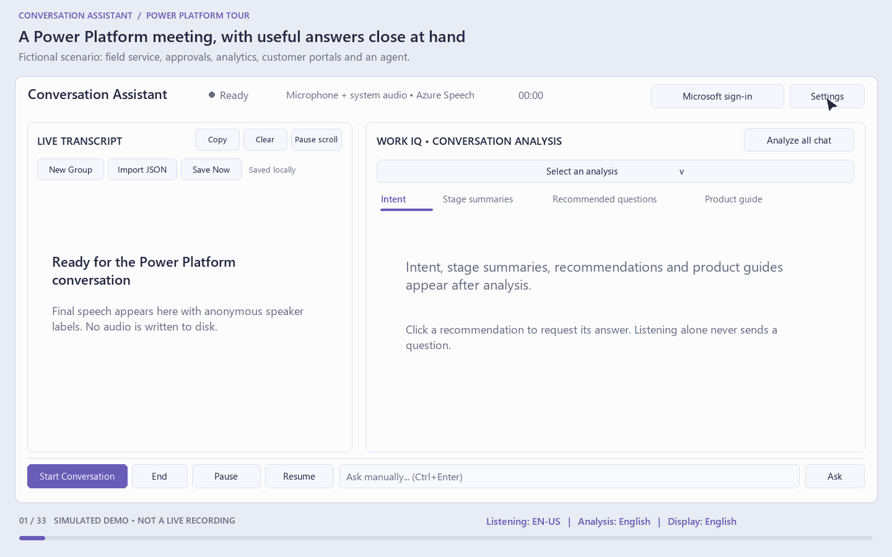

# Power Platform animated tour

[Open the animated GIF](conversation-assistant-power-platform.gif)

## What it demonstrates

This is a **fictional UI simulation**, not a recording of a running application. It makes no Speech, Work IQ, authentication or other network calls. Responses, device names, authentication results and connection tests are simulated. Tenant/client IDs and endpoints are placeholders, not usable configuration.

All visible text is English. The tour explicitly selects:

| Setting | Demo selection |
| --- | --- |
| Listening language | English (en-US) |
| Analysis language | English |
| Display language | English |

The demo does **not** modify the application's saved settings or Chinese defaults.

### Storyboard

The 33 scenes follow a fictional field-service discovery meeting involving **Power Apps, Power Automate, Power BI, Power Pages, Copilot Studio and Dataverse**:

- Compact Settings: independent languages, Azure Speech/Entra configuration and consent, explicit Whisper offline mode and local-model readiness.
- Audio sources and devices: microphone, system audio, shared capture, device refresh and privacy.
- Context window, concise answer style, automatic analysis and local JSON/audio-storage policy.
- Simulated sign-in; start, pause, resume and end a conversation.
- Speaker-labeled English transcript with partial-to-final text, grouping, renaming and group analysis.
- Intent, accumulating stage summaries, analysis history and concise expert recommendations; hover details, click-to-ask and edit-before-sending.
- Context-relevant product cards with license/cost-input tables and limitation tables, without reference-link appendices.
- Independent question/answer history, answer expansion, rich/original view and copy/retry/dismiss controls.
- Illustrated automatic recovery from malformed analysis; no partial result committed.
- Save and import readable JSON records without automatically restarting capture or Work IQ.

**Licensing and pricing are illustrative verification questions and symbolic inputs, not verified product terms, current prices or a quote.** Review the applicable official terms before making a real customer commitment.

## Assets

| File | Purpose |
| --- | --- |
| [Animated GIF](conversation-assistant-power-platform.gif) | 1440 × 900, looping, 110 encoded frames, 40.6 seconds at 3× speed, approximately 1.03 MiB |
| [Preview](conversation-assistant-power-platform-preview.png) | Full-resolution product-guide example |
| [Storyboard sheet](conversation-assistant-power-platform-storyboard.png) | Static overview of the 33 scenes, read left-to-right and top-to-bottom |
| [Scene manifest](conversation-assistant-power-platform.json) | Machine-readable languages, scene captions, products and timing |
| [Generator](../../tools/generate_demo_gif.py) | Reproducible Pillow renderer with structural validation |

## Regenerate

From the repository root, run `python tools/generate_demo_gif.py --speed 3` to reproduce the current 3× animation. The scene content is unchanged; the original 121.8-second tour now plays in 40.6 seconds. Omit `--speed` for the original pacing. GIF timing is rounded cumulatively to its 10 ms resolution to avoid accumulating playback drift.

Requires Python 3.10+, Pillow, and either Windows Segoe UI or Linux DejaVu Sans fonts. These are documentation-generation requirements only; no application runtime packages are added. Use `--output <directory>` to write the assets elsewhere. The script performs no network access and never loads user settings, recordings or credentials.

The generator checks layout bounds for wrapped text/buttons/product tables, GIF dimensions, looping, frame decoding, total duration and language selections. The generated GIF was also decoded independently with FFmpeg. These checks validate the media assets, **not** live application or service behavior.
