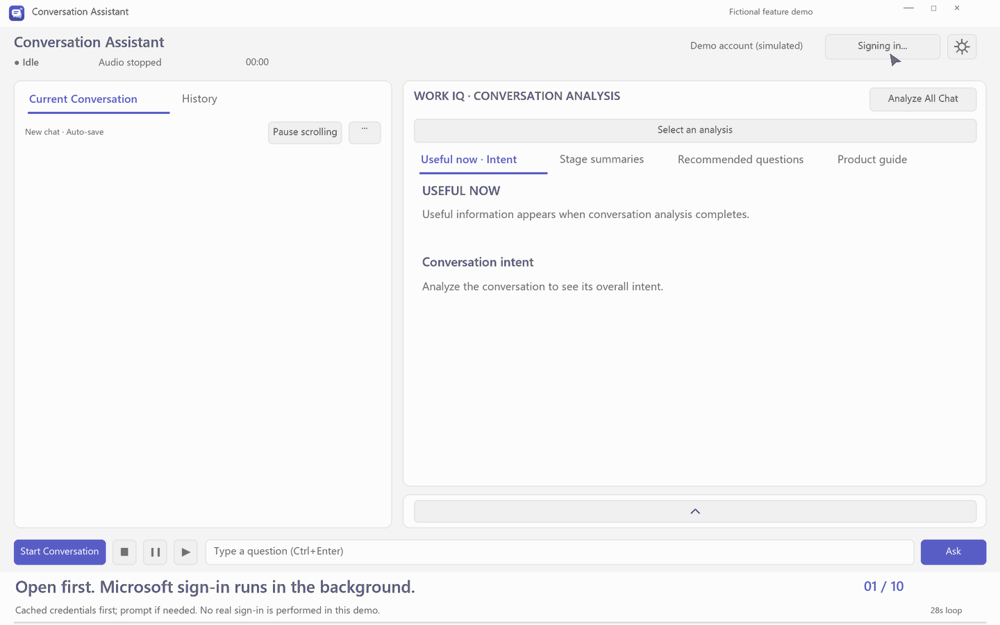
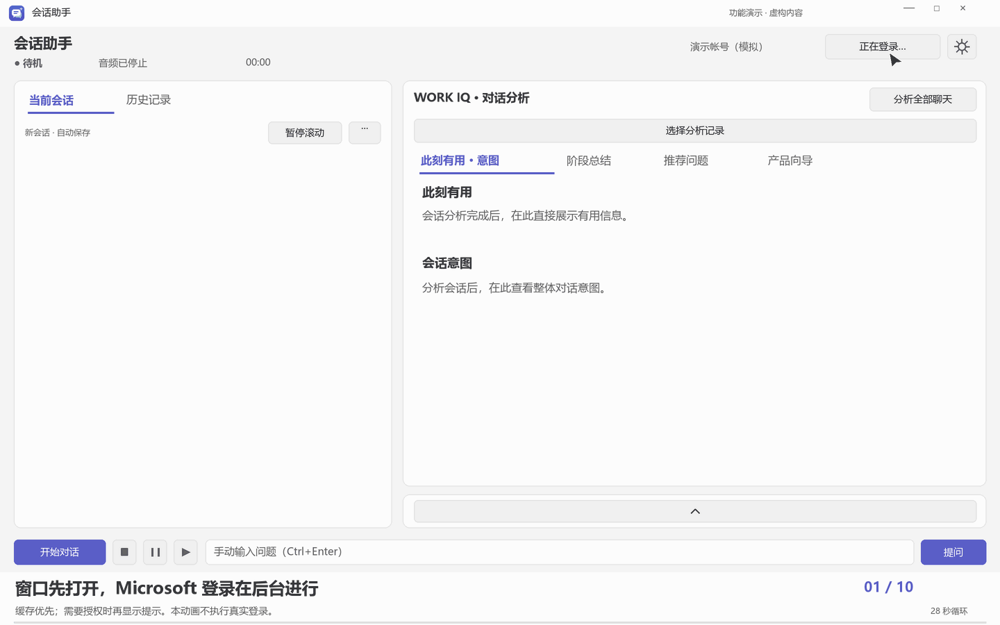
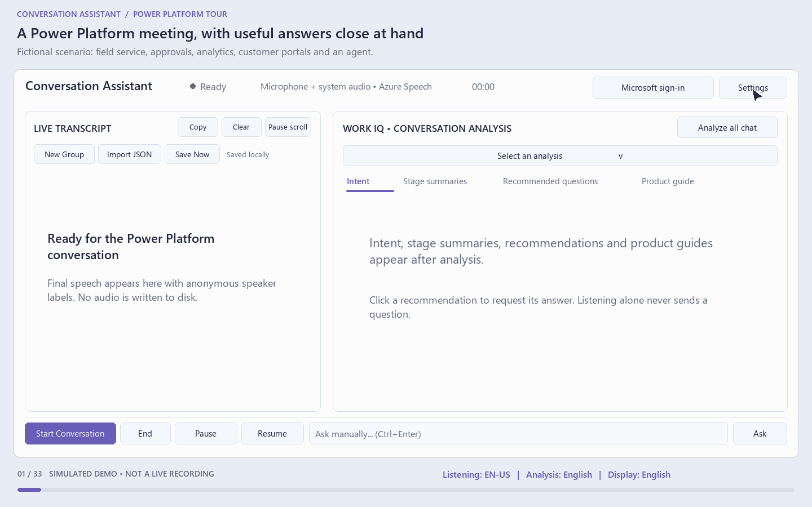

# Animated feature tours

## Current-version English tour — 28 seconds

[Open the English GIF](conversation-assistant-current-en.gif) · [Full-size preview](conversation-assistant-current-en-preview.png) · [Storyboard](conversation-assistant-current-en-storyboard.png) · [Chinese version](conversation-assistant-current-zh.gif)

The matching English edition uses the same ten-scene, 28-second storyboard described below. All visible app labels, captions, fictional conversations, history entries, product guidance and replies are English. English text uses word wrapping and appropriately sized tabs and controls. The generated manifest audits visible text and rejects untranslated Chinese.

This is a **fictional UI simulation, not a live recording**. It does not open the installed app, access saved conversations or credentials, change language settings, or call Microsoft, Speech or Work IQ services. Simulated replies and product information are not verified licensing terms, prices or a quote.

| File | Purpose |
| --- | --- |
| [English GIF](conversation-assistant-current-en.gif) | 1440 × 900, 41 frames, 28.0 seconds, looping, approximately 0.57 MiB |
| [English preview](conversation-assistant-current-en-preview.png) | Full-size current-layout still |
| [English storyboard](conversation-assistant-current-en-storyboard.png) | Ten-scene overview |
| [English manifest](conversation-assistant-current-en.json) | Captions, timings, visible-text audit and English-source fingerprints |
| [English copy](../../tools/current_demo_english.py) | Translated fictional demo content |

Run `python tools/generate_current_demo.py --language en-US` from the repository root to regenerate the English files. Validate them with `python tools/generate_current_demo.py --language en-US --check`. English rendering requires Segoe UI on Windows or DejaVu Sans on Linux, plus Python 3.10+ and Pillow. FFmpeg/FFprobe independently confirmed **28.000000 seconds** and decoded every frame successfully.

The existing Chinese GIF, preview, storyboard and manifest are preserved byte-for-byte. The default generator language remains Chinese; pass `--language zh-CN --check` to validate it explicitly.

## Current-version Chinese tour — 28 seconds

[Open the 28-second GIF](conversation-assistant-current-zh.gif) · [Full-size preview](conversation-assistant-current-zh-preview.png) · [Storyboard](conversation-assistant-current-zh-storyboard.png)

This short tour reflects the current Teams-inspired light-theme interface and Chinese labels. It is a **fictional UI simulation, not a screen recording**. Conversations, history entries, sign-in results, product information and replies are invented. The generator reads repository sources and the app icon only; it never opens the app, user records, settings, credentials, microphone or network. No live Microsoft, Speech or Work IQ operations are performed.

### Coverage and timing

| Scene | Duration | Demonstration |
| --- | ---: | --- |
| Startup | 2.2 s | Window first, background Microsoft sign-in illustrated |
| Live transcript | 3.2 s | Speaker-labeled, read-only turns; analysis appears after seven final turns |
| History | 3.0 s | End capture, show 20% start / 20% end / 60% intent columns, then load a saved record |
| Useful now and intent | 3.6 s | Assistance, references and intent in one Select All scope |
| Stage summaries | 2.6 s | All stage paragraphs selected together |
| Recommendations | 2.8 s | An explicit question selection opens a simulated reply |
| Product guide | 2.6 s | Conversation-relevant capability and governance checks |
| Answer expansion | 3.0 s | Enlarged reply area and compact utility menu |
| Right-click collapse | 1.8 s | Hide answer content while retaining the restore toggle |
| New Chat | 3.2 s | Save the old workspace, then reset both panes and start a fresh chat |
| **Total, including cursor transitions** | **28.0 s** | **41 encoded frames; looping** |

History timestamps use minute precision. Transcript cards do not submit questions. Import is illustrated only after capture stops; it does not resume recording. The New Chat sequence separately illustrates saving before fresh capture begins. Product/licensing statements are illustrative checks, **not verified terms, prices or a quote**.

### Assets and regeneration

| File | Purpose |
| --- | --- |
| [GIF](conversation-assistant-current-zh.gif) | 1440 × 900, 28.0 seconds, approximately 0.58 MiB |
| [Preview](conversation-assistant-current-zh-preview.png) | Full-size current-layout still |
| [Storyboard](conversation-assistant-current-zh-storyboard.png) | Ten-scene overview, left-to-right and top-to-bottom |
| [Manifest](conversation-assistant-current-zh.json) | Chinese captions, per-frame timing, history proportions and source fingerprints |
| [Generator](../../tools/generate_current_demo.py) | Reproducible renderer and validation |

From the repository root, run `python tools/generate_current_demo.py` to regenerate the assets. Run `python tools/generate_current_demo.py --check` to validate existing exports without modifying them. Use `--output <directory>` for another output folder.

Requires Python 3.10+, Pillow, and Microsoft YaHei on Windows or Noto Sans CJK on Linux. Missing CJK fonts fail explicitly rather than substituting unreadable glyphs. UI icons are vector-drawn where font glyphs are unavailable. These are documentation-generation requirements only; no application packages are added.

Validation checks current UI contracts, source fingerprints, drawing bounds, all decoded GIF frames, looping and the actual encoded duration strictly below 30 seconds. The delivered file was also decoded independently using FFmpeg/FFprobe, which reported **28.000000 seconds**. Regenerate after changing the fingerprinted app sources. These checks validate the media artifact, not live service behavior.

## Previous English Power Platform tour

[Open the animated GIF](conversation-assistant-power-platform.gif)

### What it demonstrates

This is a **fictional UI simulation**, not a recording of a running application. It makes no Speech, Work IQ, authentication or other network calls. Responses, device names, authentication results and connection tests are simulated. Tenant/client IDs and endpoints are placeholders, not usable configuration.

All visible text is English. The tour explicitly selects:

| Setting | Demo selection |
| --- | --- |
| Listening language | English (en-US) |
| Analysis language | English |
| Display language | English |

The demo does **not** modify the application's saved settings or Chinese defaults.

#### Storyboard

The 33 scenes follow a fictional field-service discovery meeting involving **Power Apps, Power Automate, Power BI, Power Pages, Copilot Studio and Dataverse**:

- Compact Settings: independent languages, Azure Speech/Entra configuration and consent, explicit Whisper offline mode and local-model readiness.
- Audio sources and devices: microphone, system audio, shared capture, device refresh and privacy.
- Context window, concise answer style, automatic analysis and local JSON/audio-storage policy.
- Simulated sign-in; start, pause, resume and end a conversation.
- Speaker-labeled English transcript with partial-to-final text, grouping, renaming and group analysis.
- Intent, accumulating stage summaries, analysis history and concise expert recommendations; hover details, click-to-ask and edit-before-sending.
- Context-relevant product cards with license/cost-input tables and limitation tables, without reference-link appendices.
- Independent question/answer history, answer expansion, rich/original view and copy/retry/dismiss controls.
- Illustrated automatic recovery from malformed analysis; no partial result committed.
- Save and import readable JSON records without automatically restarting capture or Work IQ.

**Licensing and pricing are illustrative verification questions and symbolic inputs, not verified product terms, current prices or a quote.** Review the applicable official terms before making a real customer commitment.

### Assets

| File | Purpose |
| --- | --- |
| [Animated GIF](conversation-assistant-power-platform.gif) | 1440 × 900, looping, 110 encoded frames, 40.6 seconds at 3× speed, approximately 1.03 MiB |
| [Preview](conversation-assistant-power-platform-preview.png) | Full-resolution product-guide example |
| [Storyboard sheet](conversation-assistant-power-platform-storyboard.png) | Static overview of the 33 scenes, read left-to-right and top-to-bottom |
| [Scene manifest](conversation-assistant-power-platform.json) | Machine-readable languages, scene captions, products and timing |
| [Generator](../../tools/generate_demo_gif.py) | Reproducible Pillow renderer with structural validation |

### Regenerate

From the repository root, run `python tools/generate_demo_gif.py --speed 3` to reproduce the current 3× animation. The scene content is unchanged; the original 121.8-second tour now plays in 40.6 seconds. Omit `--speed` for the original pacing. GIF timing is rounded cumulatively to its 10 ms resolution to avoid accumulating playback drift.

Requires Python 3.10+, Pillow, and either Windows Segoe UI or Linux DejaVu Sans fonts. These are documentation-generation requirements only; no application runtime packages are added. Use `--output <directory>` to write the assets elsewhere. The script performs no network access and never loads user settings, recordings or credentials.

The generator checks layout bounds for wrapped text/buttons/product tables, GIF dimensions, looping, frame decoding, total duration and language selections. The generated GIF was also decoded independently with FFmpeg. These checks validate the media assets, **not** live application or service behavior.
