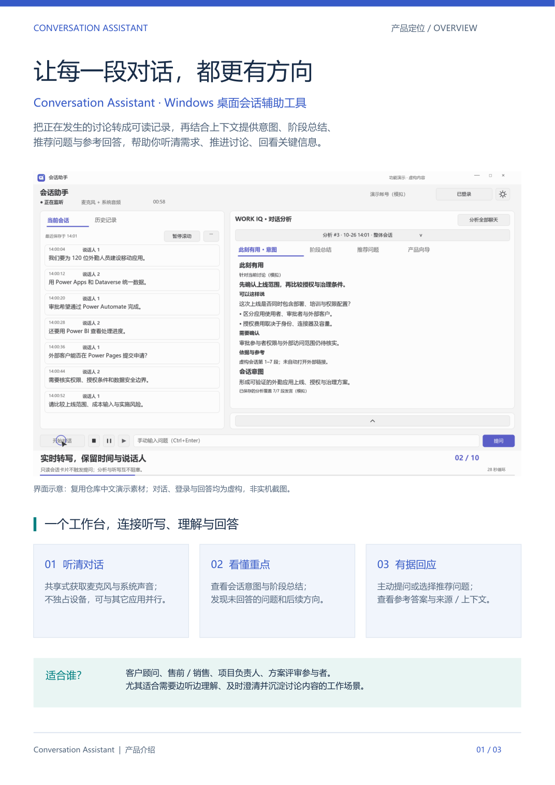
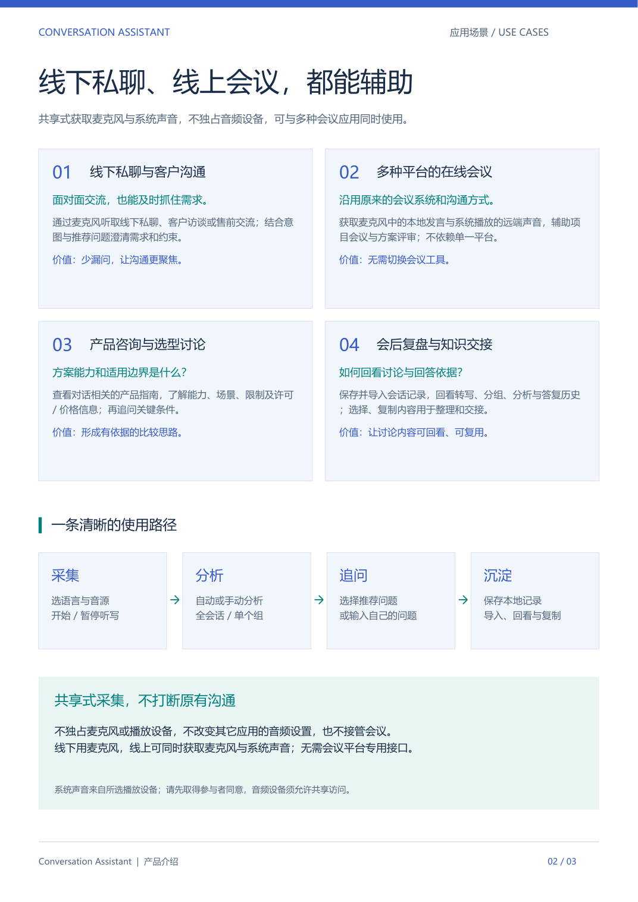
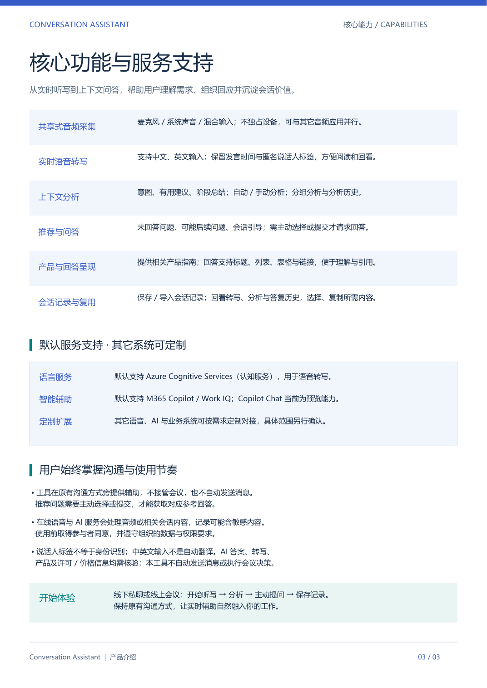

# Conversation Assistant 产品介绍

[打开三页 PDF](ConversationAssistant-产品介绍.pdf)

简体中文、三页 A4 竖版。PDF 使用可搜索的文字、嵌入式中文字体、界面示意图与矢量流程图；不需要安装字体即可阅读。

## 页面内容

1. **产品定位**：工具解决什么问题，界面示意，以及听写、理解、回答三个环节。
2. **应用场景**：线下私聊与客户沟通、多种平台的在线会议、产品咨询与选型讨论、会后复盘与知识交接；突出共享式音频采集与使用流程。
3. **核心功能与服务支持**：语音转写、上下文分析、推荐问答、产品指南和记录复用；只介绍默认服务、定制选项及用户侧注意事项，不包含部署或开发细节。

| 第 1 页 | 第 2 页 | 第 3 页 |
| --- | --- | --- |
|  |  |  |

## 内容依据

- [仓库 README](../../README.md)：已实现能力、配置、数据流与已知限制。
- [中文演示说明](../demos/README.md)：界面示意图及其限制。
- 第 1 页图片来自仓库现有中文 GIF 的实时转写场景。它是**虚构界面模拟，不是实机截图**；不含真实对话、登录、服务请求或经过核验的价格信息。
- 场景与示例说明现有功能的使用方式，不承诺行业专用功能、自动执行操作、识别准确率或业务效果。
- [音频采集实现](../../App/Audio/WasapiAudioDeviceFactory.cs)采用共享模式，不独占麦克风或播放设备，不改变其它应用的音频设置；可在原有线下或在线沟通方式旁提供辅助。音频设备须允许共享访问，不承诺所有会议平台或设备组合均经过验证。
- 服务介绍仅保留默认支持 Azure Cognitive Services 与 M365 Copilot / Work IQ、其它系统可按需定制对接；定制范围需另行确认，不代表已有现成连接器。Copilot Chat 是预览能力。
- 不把匿名说话人标签描述为身份识别，也不把中英文输入描述为自动翻译。

## Regenerate

Run from the repository root with Python 3.10+ and the documentation-only packages **PyMuPDF** and **Pillow**. No application dependency or project file is changed. If these Python packages are missing, install them with `python -m pip install PyMuPDF Pillow` in your documentation environment.

- Generate PDF and previews: `python tools/generate_product_brochure.py`
- Validate the existing PDF without rewriting it: `python tools/generate_product_brochure.py --check`
- Choose another output folder: `python tools/generate_product_brochure.py --output <directory>`
- Choose a CJK font: `python tools/generate_product_brochure.py --font <font-path>`

The generator uses Microsoft YaHei on Windows or Noto Sans CJK on Linux by default. Missing Chinese glyphs cause an explicit failure instead of an unreadable substitute. Font subsetting embeds the glyphs used in the PDF. PNG previews are rendered from the finished PDF, not from a separate layout.

Validation checks three pages, searchable Chinese and the revised scenario / service terms, absence of deployment / development details in PDF text, embedded fonts, page bounds, the interface image, and vector cards / workflow. These checks validate the brochure artifact, not live speech or AI service behavior. When application behavior changes, review the brochure copy and demo asset before regenerating.
